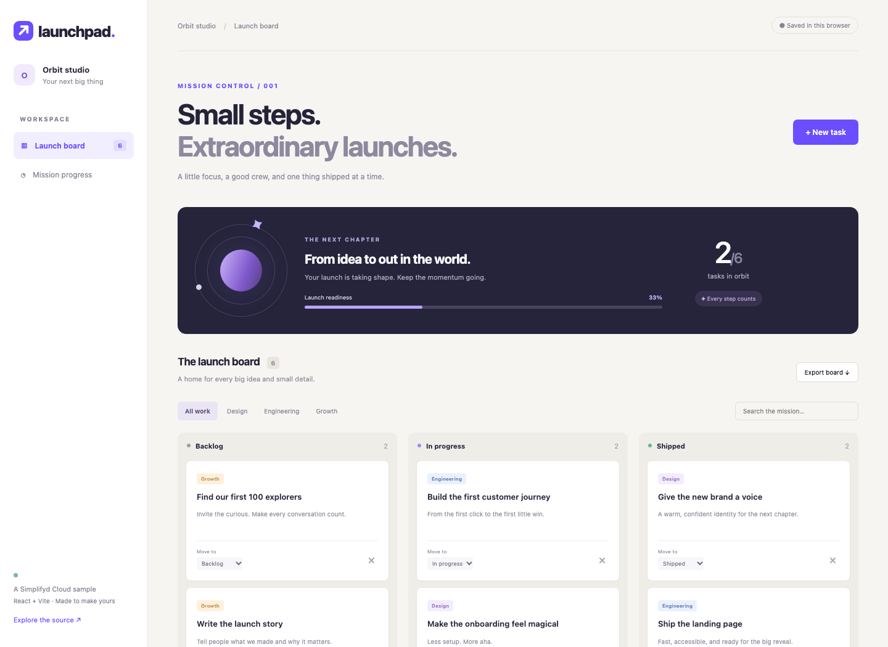

# Launchpad — React launch planner

[](https://github.com/SimplifydCloud/sample-react-launchpad/actions/workflows/ci.yml)

A small mission control for your next big idea. A responsive React + Vite app with a working three-stage task board, team filters, search, live launch progress, JSON export, and browser persistence. No account, backend, or API key required.



## Try it locally

Use **Use this template → Create a new repository**, or clone the sample:

```sh
git clone https://github.com/SimplifydCloud/sample-react-launchpad.git
cd sample-react-launchpad
npm ci
npm run dev
```

Requires **Node 22.12+**. Open the URL printed by Vite. Create a task, move it to Shipped, reload, and watch your progress stick. **Reset demo** restores the starting board. Browser storage is local to the current origin; sharing a URL does not share a board.

## Deploy on Simplifyd Cloud

1. Create a repository from this template in your GitHub account.
2. In your Simplifyd project, choose **Add → Static Site** and apply the change.
3. Open the site's **Settings → Build → Deploy from GitHub**, connect GitHub, and grant the Simplifyd GitHub App access to your new repository.
4. Select your repository and `main` branch. Keep the app directory at the repository root.
5. Detect the framework, then review these settings and build:

| Setting | Value |
| --- | --- |
| Node | `22` |
| Install | `npm ci` |
| Build | `npm run build` |
| Output directory | `dist` |
| Environment variables | None |

Open the Site URL. Future pushes to `main` build new releases. The Releases tab has logs and rollback. Managed GitHub builds must be enabled on your Simplifyd installation.

For a manual upload, run `npm run build`, zip the **contents** of `dist` with `index.html` at the zip root, and upload it in the site's Files tab. You can also serve the same build as a container:

```sh
docker build -t launchpad .
docker run --rm -p 8080:8080 launchpad
```

## Checks

```sh
npm run build
npx playwright install chromium
npm test
```

Browser tests cover creating, moving, persisting, searching, and deleting tasks, plus mobile overflow. GitHub Actions runs the build and Chromium tests on every push and pull request.

## Make it yours

- Edit the seed board in `src/main.jsx`.
- Change the brand and palette in `src/style.css`.
- Replace browser storage with an API when you need a shared board.

React handles the UI; Vite produces static files; Nginx is only used for the optional container. `vite preview` is a local verification server.

[More Simplifyd samples](https://github.com/SimplifydCloud/sample-projects) · [Vite deployment documentation](https://vite.dev/guide/static-deploy) · MIT licensed.
